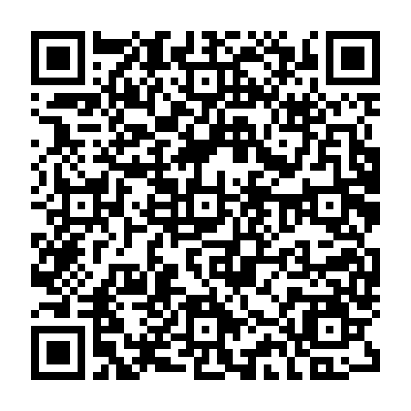

# Synex Health 개인용 테스트판 — 601b0eb

[최신 APK 다운로드](https://raw.githubusercontent.com/hundol047/Synex-Health/synex-apk-personal-20261025/Synex-Health-Personal-601b0eb.apk)

학교·캠퍼스 51곳, 43개 대학의 공식 센터 안내 44곳, 체성분 검사 안내 12곳을 포함합니다. 전국 모든 학교의 전수 확인이나 실제 기관 연동을 의미하지 않습니다.

소스: 601b0eb066d355e421ec88e66362d63e8ec9ec99
APK 및 개인용 브라우저·Android 네이티브 검증 성공: https://github.com/hundol047/Synex-Health/actions/runs/40273395859
별도 서버 모드 브라우저 CI 6개 실패는 남아 있습니다. 정식 출시판이 아닌 기기 전용 테스트판입니다.

기존 테스트판과 서명이 다르면 덮어쓰기가 되지 않을 수 있습니다. 기존 앱에서 암호화 백업을 저장하고 파일과 암호를 확인하기 전에는 앱을 삭제하지 마세요.

파일 크기: 33,902,456 bytes. SHA256SUMS에서 무결성을 확인할 수 있습니다.
