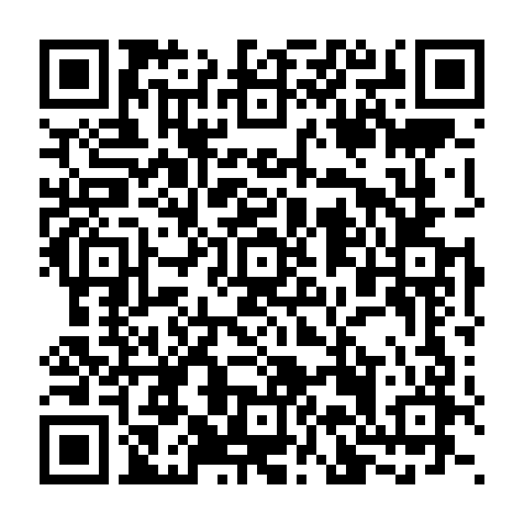

# Synex Health 검증판 — 6c1154e

[Android 앱 다운로드](https://raw.githubusercontent.com/hundol047/Synex-Health/synex-apk-personal-20261025/Synex-Health-Preview-6c1154e.apk)

운동 화면을 열 때 신체·머리·손 계산을 재사용하도록 최적화했습니다. 로딩 중 운동 시간이 먼저 흐르지 않으며 시범이 준비된 뒤 처음 자세부터 자동 재생됩니다. 3D를 지원하지 않는 기기에서도 간단 동작 안내로 전환해 재생합니다. 피부색·눈 크기·가슴 크기·머리·운동복 설정과 포니테일 움직임을 포함합니다.

기존 Synex Health 검증판 위에 업데이트 설치하세요. 기록 보존을 위해 기존 앱을 삭제하지 마세요. 오래된 개인용 앱과는 별도 패키지이며, 그 앱의 기록 이전에는 암호화 백업 확인·복원이 필요합니다.

앱 이름: Synex Health 검증판
패키지: com.synex.health.personal.preview
versionCode: 200103 (이전 공개 검증판: 200095)
앱 소스: 6c1154e00e45a54d8bf1ca16d56f63888edf1e36
빌드 기록: https://github.com/hundol047/Synex-Health/actions/runs/41026368224

전체 단위 테스트, 세 묶음의 브라우저 검사와 Android 에뮬레이터의 후보 APK 업데이트·암호화 기록 보존 검사를 확인한 배포입니다. 서명 후 후보와 코드·리소스 동일성, 이전 공개 검증판과 패키지·서명 동일성 및 버전 증가를 확인했습니다. 최종 공개 APK 쌍의 실물 휴대전화 검증을 뜻하지 않습니다.

로딩 개선 수치는 개발 환경의 계산 측정이며 실제 휴대전화 전체 로딩 속도·발열을 보증하지 않습니다. 머리 움직임은 운동 진행도에 맞춘 제한된 연출이며 물리 시뮬레이션이 아닙니다. 모든 체형·운동 조합의 충돌이나 실사 품질을 보증하지 않습니다. 카메라 색상·근육 안내는 실제 근육 사용량 측정이 아닙니다. 정식 출시판이 아닌 검증판입니다.

파일 크기: 34,003,962 bytes
SHA-256: 881c14c793bfaf9e8edf54aa56cfc3fd27ee061529d43b49b93794aef51474b2
서명 인증서 SHA-256: 62552472fcb89d4318e6837cae19f2778ef1a8260038e1d06b46bcc0128007b2
