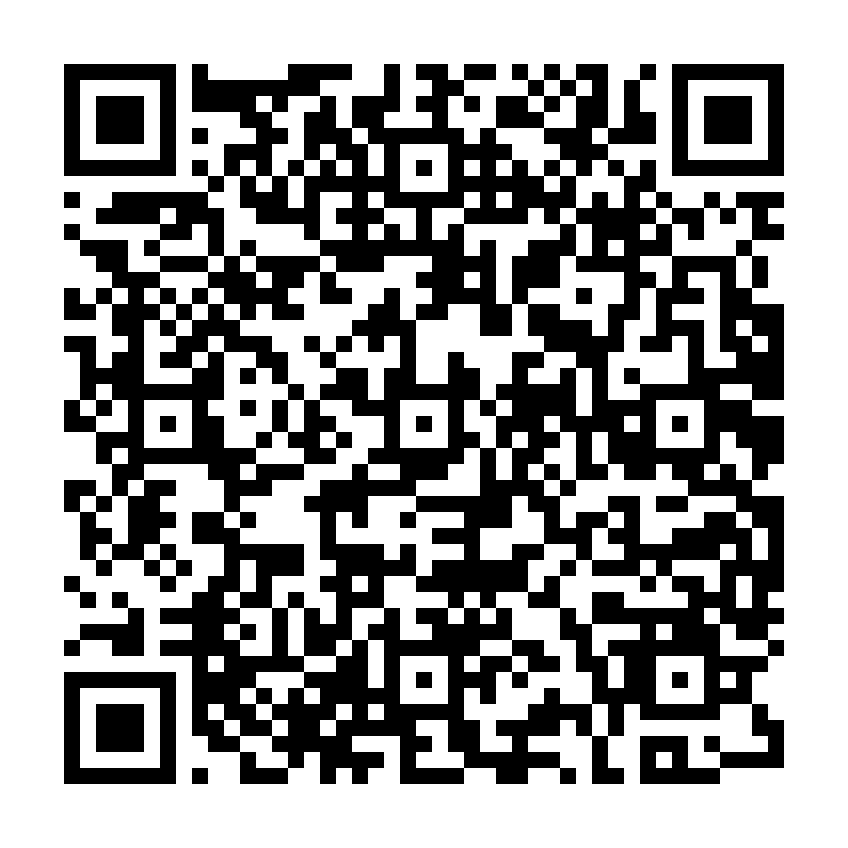

# Synex Health 검증판 — 0ef66b8

[Android 앱 다운로드](https://raw.githubusercontent.com/hundol047/Synex-Health/synex-apk-personal-20261025/Synex-Health-Preview-0ef66b8.apk)

손목 꺾임과 손가락 표면 뒤틀림을 수정하고, 운동 인체와 체성분 마네킹의 유두 표현을 제거했습니다. 동작 보기를 누르면 다른 화면이나 팝업으로 이동하지 않고 같은 운동 카드 안에서 시범이 자동 재생됩니다. 엎드린 Y 운동의 바닥 지지 높이도 보정했습니다.

이전 Synex Health 검증판 위에 설치할 수 있도록 패키지와 서명을 유지하고 버전을 올렸습니다. 기존 앱은 삭제하지 마세요. 오래된 개인용 앱과는 별도로 설치되며 기록 이전에는 암호화 백업 확인·복원을 사용하세요.

앱 이름: Synex Health 검증판
패키지: com.synex.health.personal.preview
versionCode: 200073 (이전 공개 검증판: 200061)
앱 소스: 0ef66b8dfaf003f582edf4b03c17f1bf02576cdb
빌드 기록: https://github.com/hundol047/Synex-Health/actions/runs/40424560425

단위 테스트, 세 묶음의 브라우저 검사 및 Android 가상 기기의 후보 APK 업데이트·암호화 기록 보존 검사를 통과했습니다. 배포 APK는 검사받은 코드·리소스를 유지하고 보관된 검증판 키로 다시 서명했습니다. 이전 공개 APK와 패키지·서명 동일성 및 버전 증가를 확인했습니다. 최종 서명 APK 쌍의 실기기 설치 검증을 뜻하지 않습니다.

인체 색상은 운동 부위 안내이며 실제 근육 사용량 측정이 아닙니다. 실제 사람 영상 분석 정확도와 실물 휴대전화 장시간 사용 검증은 완료되지 않았습니다. 정식 출시판이 아닌 검증판입니다.

파일 크기: 33,987,203 bytes
SHA-256: 06029e5c0345a9729216ef4b8c5e3c738f278cfbcedc57c9676fac76d9f25b57
공개 서명 인증서 SHA-256: 62552472fcb89d4318e6837cae19f2778ef1a8260038e1d06b46bcc0128007b2
