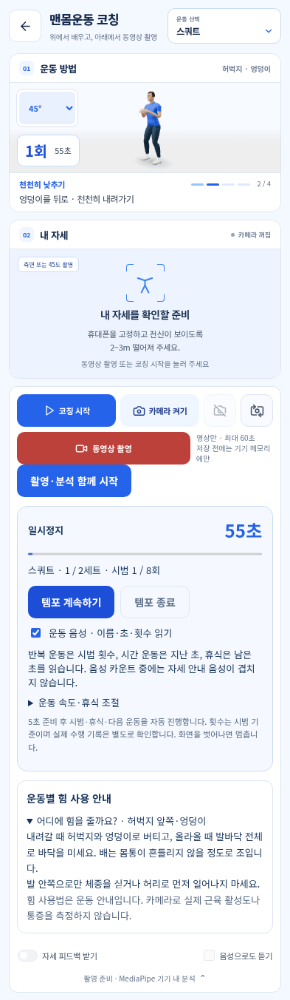
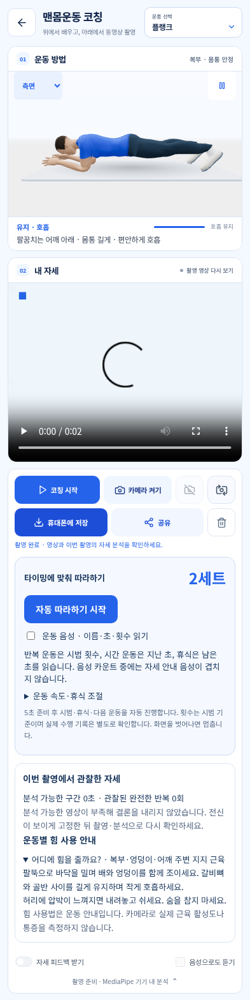
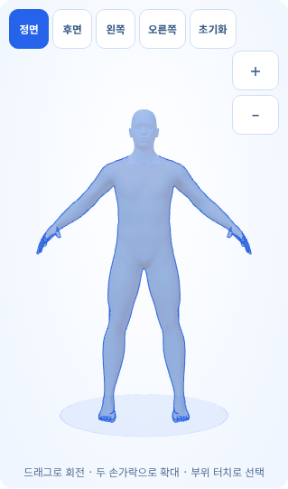

# Synex Health 수정판 1.9.tempo

[APK 다운로드](https://github.com/hundol047/Synex-Health/raw/refs/heads/synex-apk-tempo-20261017/Synex-Health-tempo.apk) · [설치 QR](https://raw.githubusercontent.com/hundol047/Synex-Health/synex-apk-tempo-20261017/Synex-Health-install-QR.png)

기존 수정판 위에 업데이트 설치하세요. 앱 ID와 서명을 유지했습니다. QR은 APK 다운로드를 엽니다. 기존 앱을 지우지 않아도 됩니다.

## 자동 운동과 한국어 음성

운동 상세와 카메라 코치에서 자동 따라하기를 시작하면 5초 준비 뒤 같은 타이머에 맞춰 3D 시범과 카운트가 진행됩니다. 루틴 화면의 자동 시범은 운동·휴식·다음 운동을 이어갑니다. 휴식은 운동 종류와 루틴 처방을 반영하며 10–120초로 조절합니다. 마지막 운동 뒤에도 회복 시간이 있습니다. 시간 운동은 지난 초, 반복 운동은 시범 횟수를 읽고 운동 이름·준비·휴식 남은 시간도 안내합니다. 음성 체크박스를 켜세요. Android는 설치된 오프라인 한국어 TTS 음성을 사용하며, 없으면 설정 안내가 나옵니다. 화면을 벗어나면 타이머와 음성을 멈춥니다. 자동 시범을 실제 수행 기록으로 저장하지 않으며 기록 화면에서 직접 확인합니다.

## 실제 관찰을 바탕으로 한 촬영 피드백

촬영·분석 함께 시작을 누르면 MediaPipe가 기기에서 관절을 추적합니다. 화면상 각도, 골반·몸통 정렬, 보폭, 무릎 방향에 따라 교정 내용이 달라지고 운동별 힘 사용법을 함께 설명합니다. 골반 처짐과 과도한 들림은 반대 방향으로 안내하며, 가려짐·잘못된 촬영 방향·짧은 추적은 판정을 보류합니다. 촬영 후 분석 가능한 시간과 관찰된 교정 항목을 요약합니다. 근육 활성도·통증을 영상으로 측정하지 않습니다.

총 74종의 시범·음성 템포를 제공합니다. 맨몸 42종에서 촬영하며, 관절 교정은 스쿼트·런지·사이드 런지·푸시업·플랭크·힙힌지·글루트 브리지 7종입니다. 나머지 운동에 분석 결과를 지어내지 않습니다. 마이크와 자동 업로드를 사용하지 않습니다.

## 투명한 신체 겹침 비교

내 몸은 파랑, 투명도 62%; 평균 비교 모형은 회색, 투명도 88%입니다. 실제 두 표면의 윤곽을 같은 위치에서 겹쳐 그리고, 평균보다 몇 kg·몇 % 많거나 적은지 위에 표시합니다. 값이 같으면 같은 형상을 유지합니다. 평균은 성인 남성 33kg·여성 21kg의 기존 문헌 기준이며, 같은 나이·키의 한국인 인바디 평균이나 부위별 실측 근육 차이가 아닙니다.

## 이번 소스의 검증

단위 테스트 408개(71개 파일), 최종 배포 브라우저 테스트 24개가 통과했습니다. 보고서는 이 소스 커밋 뒤에 새로 실행했습니다. 이전 버전 결과를 통과 수에 합산하지 않았습니다. 1.8 배포의 브라우저 보고서는 1.7 결과가 재사용되어 신규 검증 증거가 아니었으며 이번 보고서는 그 결과에 의존하지 않습니다.

브라우저에서 실제 MediaRecorder 영상 녹화·재생·다운로드, 로컬 MediaPipe 모델의 빈 장면 판정 보류, 자동 시범·음성 호출, 투명한 두 3D 표면, 저장소 재실행을 확인했습니다. 음성 단위 테스트는 이름·횟수·초와 중지·중복 방지를 검사합니다. APK 웹 자산·모델 체크섬·서명과 네이티브 녹화/음성 플러그인의 실제 DEX 등록을 확인했습니다. 물리적 Android 휴대폰의 음성 출력·카메라·저장·성능과 실제 운동 영상의 교정 정확도를 검증한 결과는 아닙니다.

Source: `a318399ea74b13640d6ce17f7ee7af11e8859cfa`. [검증 정보](VERIFICATION.json) · [단위 테스트](vitest-report.json) · [브라우저 테스트](playwright-report.json) · [체크섬](SHA256SUMS)

